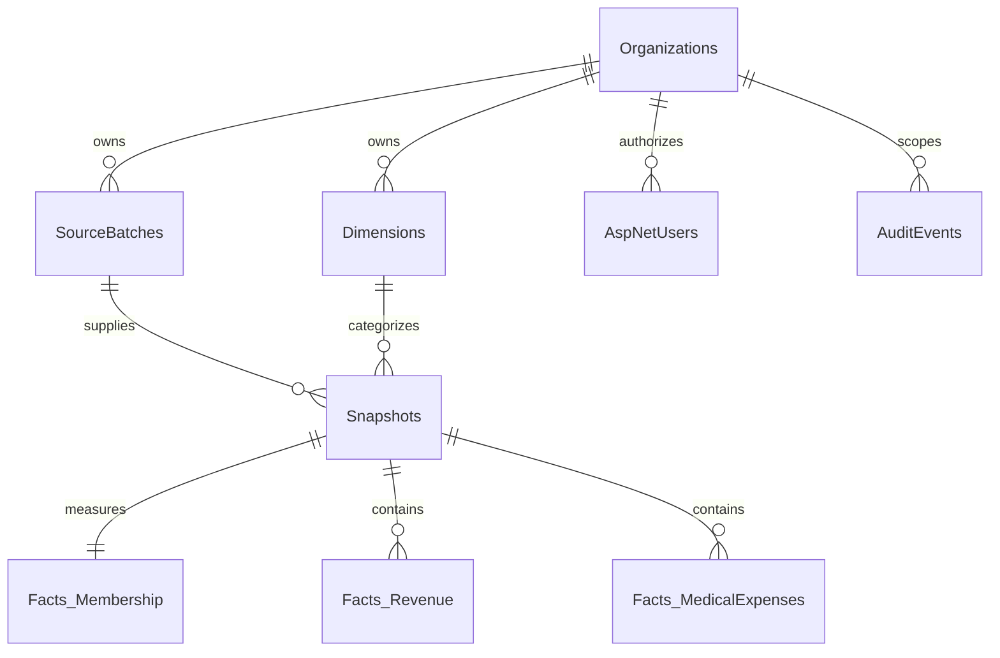

# Database foundation

The EF Core model and committed migrations in `src/Hhh.Infrastructure/Migrations` define the SQL Server schema. The derived `PostgresHhhDbContext` and separate `Migrations/Postgres` history support the hosted Neon database, including persistent encrypted Data Protection keys. SQL Server migrations and the normal local database remain independent. Phase 1 uses conformed typed dimensions in one `Dimensions` table; the wider warehouse dimensional expansion remains part of the roadmap.



Seven organization-scoped dimension references on each snapshot identify payer, center, provider, contract, plan, line of business, and region. Composite organization foreign keys prevent snapshots from referencing another organization's dimensions or source batch. A unique snapshot index includes every dimension and the effective, report, and general ledger months.

Membership has a single row per snapshot. Revenue and expense categories are decimal facts at that same cohort-period grain. Administrative expenses have an explicit flag and are excluded from operational MLR. Capitation is one revenue category; IBNR is one expense category; negative stop-loss recoveries reduce medical expense. There is no duplicated capitation or IBNR fact to count a second time.

Identity uses ASP.NET Core Identity tables for hashed passwords, roles, account lockout, and security stamps. Audit events record authentication, exports, and setting changes. The synthetic seed has 252 snapshots per organization (21 months × 3 payers × 4 non-overlapping centers).

## Migrations

Development startup applies migrations automatically to its configured HHH database. For deployment-controlled migrations:

```powershell
dotnet tool restore
dotnet ef migrations script --idempotent --context HhhDbContext --project src/Hhh.Infrastructure --startup-project src/Hhh.Api --output hhh-migrations.sql
```

Review and apply the generated script using a migration identity. Keep the runtime identity separate and least privileged. Set `ConnectionStrings__Hhh` through the environment; do not put production connection strings into tracked files. The `--migrate` API argument is also supported for an explicit one-shot migration process.

For PostgreSQL, use `--context PostgresHhhDbContext` and an operator-provided `HHH_POSTGRES_CONNECTION_STRING`, or the guarded operator described in the [cloud deployment guide](../deploy/cloud-run/README.md). Set `Database__Provider=PostgreSql` for the hosted API; its migrations are disabled at normal startup. Access administration uses a transaction-owned PostgreSQL advisory lock with a ten-second lock timeout, preserving the SQL Server application-lock behavior.

The Phase 1 seed provides one report version per effective month. Restatement ingestion and as-of selection across multiple versions must be implemented before loading financial restatements; aggregating multiple report versions together would double count results.

## Phase 2 budget schema

The additive `BudgetPlans` migration introduces versioned organization/year plans, monthly `BudgetSnapshots` at the same seven-dimension cohort grain, and categorized `Facts_Budget` amounts. Composite organization foreign keys isolate plans and dimensions. Unique indexes prevent duplicate plan versions, monthly cohort snapshots, and financial components.

Budgets are independent of actuals. Planned membership is stored once per budget cohort, and budget lines carry decimal amounts. Optional starter-data installation adds synthetic plans to a new organization's records without replacing actuals or settings. Explicit reference-demo startup preserves its existing sample plans. Runtime report comparisons match cohorts and components before calculating variance.

## MLR configuration

The additive `MlrDefinitionsAndTargets` migration stores one `MlrDefinition` per organization, unique selected revenue/medical `MlrComponents`, and unique organization/dimension `MlrTargetRule` overrides. Definition/target versions are EF concurrency tokens. Composite organization/dimension foreign keys prevent cross-organization target references.

`AuditEvents.DetailsJson` preserves definition category sets, versions, and target changes alongside the actor and time. MLR mutations and their audit events commit in the same `SaveChanges` transaction. Definition reads join their components in one statement to avoid mismatched versions and component sets during concurrent updates. Actual financial facts and budget plans are unchanged by this migration.

## Administration schema

The additive `UserAdministration` migration adds active flags and access concurrency versions to organizations/users, account creation time, pending setup status, and nullable setup token hash/expiry. Existing accounts and organizations default to active, and versions start at one. A scoped organization/display-name index supports the user directory. Identity continues to store password hashes and roles; plaintext setup links are never persisted.

Access mutations use a transaction-owned SQL Server application lock plus optimistic versions. User/role changes and audit records commit atomically. There are no hard-delete administration routes. Organization deactivation rotates user security stamps and invalidates setup links. See [administration rules](administration.md).

## Installation completion

The `InitialAdministratorSetup` migration adds the singleton `InstallationStates` row (ID 1, enforced by a check constraint) and its nullable `AdministratorSetupCompletedAt`. Existing installations with an established system administrator are marked complete during migration; development seeding also closes setup for the synthetic platform administrator. Setup keys are deployment secrets and are not stored in this table.

The normal local prototype uses `HhhLocal` with no seeded identities. `StarterFinancialData` independently installs optional financials, dimensions, approved budgets, and MLR defaults in the administrator's new organization. It runs inside account/organization creation's transaction and creates no users. The previous `HhhDevelopment` dataset and synthetic identities remain available only through explicit reference-demo startup.

Browser setup creates the first organization/user/role, password hash, audit records, and completion marker under the access-administration transaction lock. CLI account activation closes the same marker. Removing roles or changing configuration never clears it. Setup integration tests use the separate `HhhFirstAdminSetupTests` database with demo seeding disabled; their fixture cleanup/reset is restricted to that named test database.
