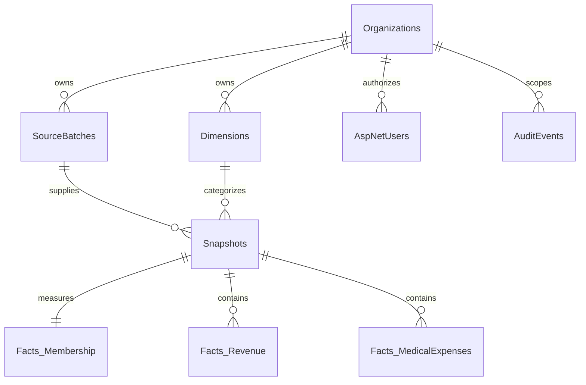

# Database foundation

The EF Core model and committed migrations in `src/Hhh.Infrastructure/Migrations` define the SQL Server schema. Phase 1 uses conformed typed dimensions in one `Dimensions` table; the wider warehouse dimensional expansion remains part of the roadmap.



Seven organization-scoped dimension references on each snapshot identify payer, center, provider, contract, plan, line of business, and region. Composite organization foreign keys prevent snapshots from referencing another organization's dimensions or source batch. A unique snapshot index includes every dimension and the effective, report, and general ledger months.

Membership has a single row per snapshot. Revenue and expense categories are decimal facts at that same cohort-period grain. Administrative expenses have an explicit flag and are excluded from operational MLR. Capitation is one revenue category; IBNR is one expense category; negative stop-loss recoveries reduce medical expense. There is no duplicated capitation or IBNR fact to count a second time.

Identity uses ASP.NET Core Identity tables for hashed passwords, roles, account lockout, and security stamps. Audit events record authentication, exports, and setting changes. The synthetic seed has 252 snapshots per organization (21 months × 3 payers × 4 non-overlapping centers).

## Migrations

Development startup applies migrations automatically to its configured HHH database. For deployment-controlled migrations:

```powershell
dotnet tool restore
dotnet ef migrations script --idempotent --project src/Hhh.Infrastructure --startup-project src/Hhh.Api --output hhh-migrations.sql
```

Review and apply the generated script using a migration identity. Keep the runtime identity separate and least privileged. Set `ConnectionStrings__Hhh` through the environment; do not put production connection strings into tracked files. The `--migrate` API argument is also supported for an explicit one-shot migration process.

The Phase 1 seed provides one report version per effective month. Restatement ingestion and as-of selection across multiple versions must be implemented before loading financial restatements; aggregating multiple report versions together would double count results.

## Phase 2 budget schema

The additive `BudgetPlans` migration introduces versioned organization/year plans, monthly `BudgetSnapshots` at the same seven-dimension cohort grain, and categorized `Facts_Budget` amounts. Composite organization foreign keys isolate plans and dimensions. Unique indexes prevent duplicate plan versions, monthly cohort snapshots, and financial components.

Budgets are independent of actuals. Planned membership is stored once per budget cohort, and budget lines carry decimal amounts. Development startup adds the synthetic plans to existing HHH databases without replacing actuals or settings. Runtime report comparisons match cohorts and components before calculating variance.
